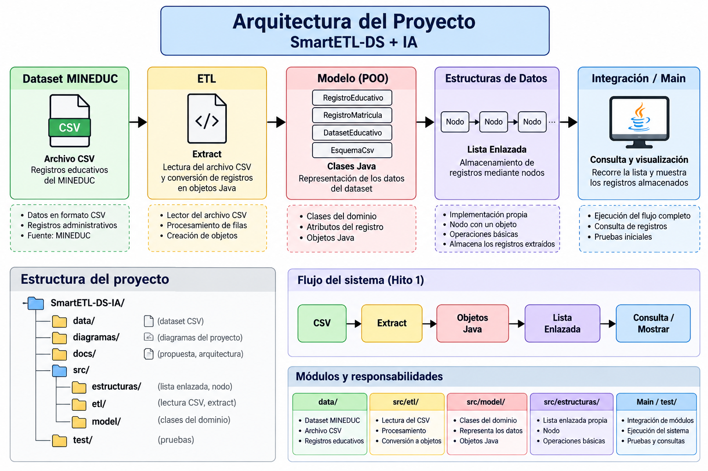

# SmartETL-DS + IA

Proyecto académico de **Estructuras de Datos** orientado al procesamiento de registros educativos del Ministerio de Educación del Ecuador (MINEDUC), utilizando Java, un proceso ETL y estructuras de datos implementadas por el equipo.

## Objetivo

Desarrollar un sistema capaz de extraer información desde un dataset educativo en formato CSV, convertir los registros en objetos Java y almacenarlos inicialmente en una lista enlazada propia.

Durante las siguientes etapas, el proyecto incorporará nuevas estructuras y algoritmos como colas, pilas, búsquedas, ordenamientos, árboles BST, grafos, BFS, DFS e Inteligencia Artificial.

## Flujo del Hito 1

`CSV → Extract → Objetos Java → Lista enlazada → Consulta de registros`

## Arquitectura



El proyecto se divide inicialmente en los siguientes módulos:

- `data/`: dataset histórico del MINEDUC (286.111 registros) y muestra de 30 registros para pruebas.
- `src/model/`: clases que representan los registros educativos (`EsquemaCsv`, `RegistroEducativo`, `RegistroMatricula`, `DatasetEducativo`).
- `src/etl/`: lectura y extracción de información desde el CSV (`LectorCsv`, `Extract`).
- `src/estructuras/`: estructuras de datos implementadas por el equipo (`Nodo<T>`, `ListaEnlazada<T>`).
- `test/`: pruebas automatizadas del sistema (`PruebasHito1`).
- `docs/`: documentación técnica del proyecto.
- `diagramas/`: representaciones visuales de la arquitectura.

## Tecnologías

- Java
- Git
- GitHub
- Visual Studio Code
- CSV

## Dataset

El proyecto utiliza registros administrativos educativos históricos (2009–2024) del Ministerio de Educación del Ecuador (MINEDUC).

Se trabaja con una muestra de 30 registros (`data/muestra_30_registros.csv`) para validaciones rápidas y con el archivo completo de 286.111 registros y 23 columnas para evaluar el comportamiento de las estructuras de datos y algoritmos implementados.

## Integrantes

- Andrés
- Cris
- Lenin
- Josué
- Héctor
- Shirley

## Documentación

La documentación del proyecto se encuentra en:

- `docs/propuesta.md`
- `docs/arquitectura.md`
- `docs/dataset.md`
- `docs/extract.md`

## Ejecución y pruebas

### Ejecutar el sistema (Windows)

Ejecutar directamente el script en la raíz del repositorio:

```bat
ejecutar.bat
```

### Ejecutar pruebas automatizadas del Hito 1

```powershell
if (!(Test-Path out)) { mkdir out }
javac -encoding UTF-8 -d out src/estructuras/*.java src/model/*.java src/etl/*.java src/Main.java test/PruebasHito1.java
java -cp out PruebasHito1
```

## Estado actual

### Hito 1 — Base ETL (Extract + Lista Enlazada) [Completado]

- [x] Repositorio GitHub creado y organizado de forma modular.
- [x] Arquitectura inicial definida.
- [x] Dataset del MINEDUC (286.111 registros) y muestra de 30 registros integrados en `data/`.
- [x] Modelo de datos implementado (`EsquemaCsv`, `RegistroEducativo`, `RegistroMatricula`, `DatasetEducativo`).
- [x] Módulo `Extract` implementado con detección de separador y validación de 23 columnas.
- [x] `Nodo<T>` y `ListaEnlazada<T>` implementados con inserción en O(1).
- [x] Integración en `Main.java` y script `ejecutar.bat` corregido.
- [x] Pruebas automatizadas del Hito 1 (`test/PruebasHito1.java`) verificadas (15/15 pasadas).

### Próximos hitos (En planificación)

- [ ] Fase `Transform`: limpieza de espacios, normalización de `Zona` y conversión de campos numéricos con separador de miles (`Total_Estudiantes`, `Promovidos`, `No promovidos`, `Abandono`).
- [ ] Fase `Load`: exportación de resultados limpios y reportes a CSV/TXT.
- [ ] Estructuras adicionales: Pilas, Colas, Búsquedas, Ordenamientos, Árbol BST y Grafos (BFS/DFS).
- [ ] Módulo de análisis / IA sobre deserción y promoción estudiantil.